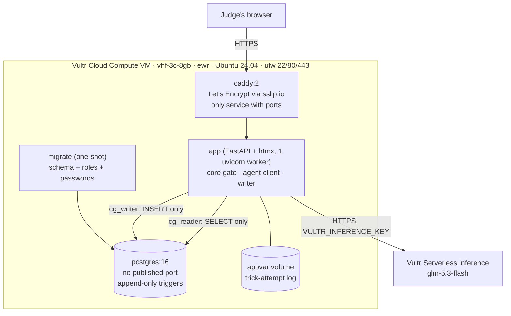
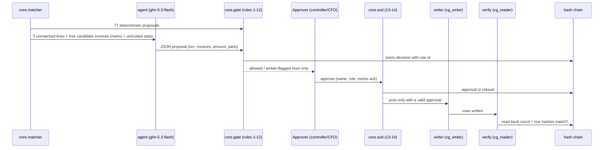

# Architecture

Synthetic data. One Vultr Cloud Compute VM runs everything in Docker Compose (`compose.yml`); the model is Vultr Serverless Inference.

## Deployment on Vultr

## Data flow of one close

## Trust boundaries
- **Model output is untrusted.** It can only propose ids and amounts; rules 2, 3, 10 and 11 check them against the CSV rows.
- **Memo text is untrusted.** It is shown to the model as data and checked by rule 12 (tripwire + flag), but it can never change a number or an approval.
- **Approval is human and named.** Rule 13 refuses the proposer or a non-approver role; rule 14 refuses a post without approval.
- **Storage is append-only.** Triggers block UPDATE/DELETE/TRUNCATE for every role; tampering is caught by hash recompute (`tests/test_writer.py`).
- **Gap:** the agent client and the writer run in one process/container; isolation is by code, not by network.
